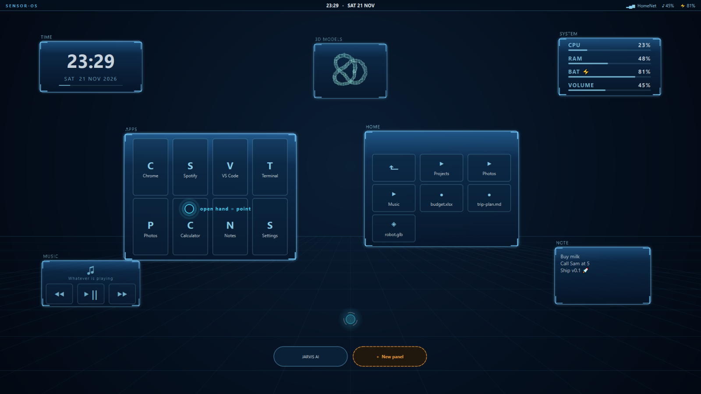
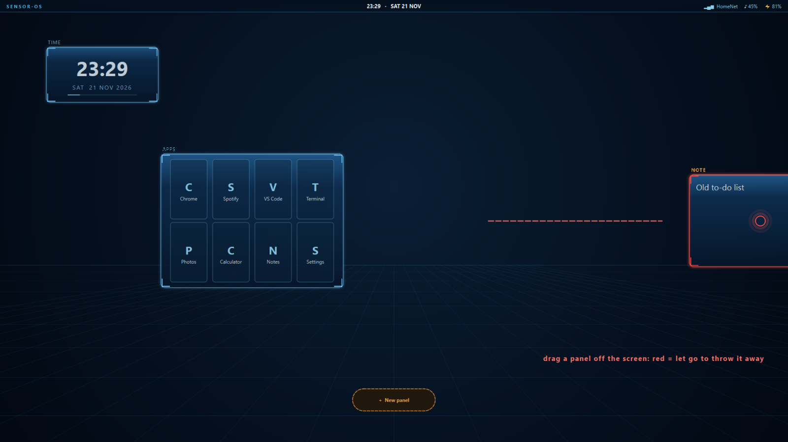
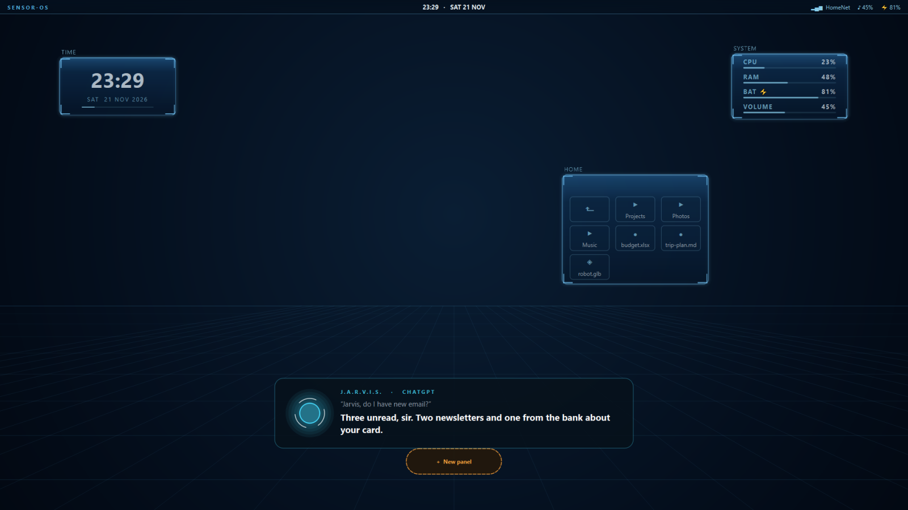

# sensor-OS

Control your computer with your hands through an ordinary webcam, with a JARVIS-style heads-up display and
a voice assistant. No extra hardware.



- **Hands:** point with an open hand, pinch to click or press, make a fist to grab windows and glass
  panels, use two hands to resize, drag things off the screen to throw them away.
- **Glass desk:** floating panels for apps, open windows, files, clock, system status, music, pictures,
  notes, power and 3D models, on top of your real programs.
- **JARVIS:** say "Hey Jarvis" (or just "Jarvis") and talk. The thinking comes from the AI subscription you
  already have (Claude, ChatGPT or Gemini), and through Claude it can use your connected services such as
  Gmail and Google Drive, asking you before it sends, changes or deletes anything.

Windows is the main platform. macOS and Linux (X11) code exists but has not been tested on real machines yet.

> Status: early and personal-project quality. It works every day on one Windows PC; expect rough edges
> elsewhere. Bug reports and pull requests are very welcome.

## Install

Python **3.12** is needed (MediaPipe does not support newer versions yet).

```bash
py -3.12 -m venv .venv
.venv\Scripts\python -m pip install -r requirements.txt
```

On macOS / Linux use `python3.12 -m venv .venv` and `.venv/bin/python`.

## Run

```bash
.venv\Scripts\python main.py
```

The first start shows a ~7 second **hand setup** (open hand, then pinch) that tunes the pinch to your hand.
The hand-tracking models are downloaded from Google on first run into `models/`.

| Option | What it does |
|---|---|
| `--dry-run` | everything on screen, but the real mouse is never touched |
| `--calibrate` | redo the hand setup |
| `--debug` | also show the camera window |
| `--mode wrist` | start in wrist (air-touchpad) mode |
| `--camera 1` | use another camera |
| `--autostart on` / `off` | start with Windows |

**Shortcuts (work anywhere)**

| Keys | Effect |
|---|---|
| `Ctrl+Alt+Q` | hand control on / off |
| `Ctrl+Alt+G` | all glass panels up / away |
| `Ctrl+Alt+J` | talk to JARVIS without the wake word |
| `Ctrl+Alt+A` | switch JARVIS's AI (Claude → Haiku → Opus → ChatGPT → Gemini, skipping ones not set up) |
| `Ctrl+Alt+C` | hand setup |
| `Ctrl+Alt+M` | switch mode |
| `Ctrl+Alt+H` | help card |
| `Ctrl+Alt+X` | quit |

On macOS the shortcuts are `Ctrl+Option+<key>`.

## The glass desk (main mode)

sensor-OS takes over the whole screen like an operating system: the taskbar and desktop icons are hidden,
a status bar sits at the top, and glass panels replace the Start menu and taskbar. Underneath it is still
your normal desktop and every program works. The screen starts clean; a clap, `Ctrl+Alt+G` or
"show panels" brings every panel out at once.

**Two gestures to remember: pinch = touch, fist = grab.**

| Do | Result |
|---|---|
| move an open hand | the pointer follows |
| pinch on a program | click (hold = right click, pinch and move = drag) |
| pinch on a panel button | press it |
| pinch and pull a panel, or a fist | carry it; open the hand to drop it |
| second hand grabs the same panel | stretch / shrink it |
| both fists on empty space, then pull apart | draw a new panel and pick what goes in it (or grab the **+** tab at the bottom) |
| pull a file out of a files panel | it becomes a panel of its own |
| move the held panel towards / away from the camera | bring it forward / push it back |
| **drag a panel off any screen edge until its border turns red, then let go** | thrown away (a real program's window goes to the shelf instead of closing) |
| clap | every panel away / back |



Panels you make are saved in `space.json`. Exit with `Ctrl+Alt+X` or the power panel; the taskbar and icons
come back at once (and are restored on the next start if sensor-OS ever crashes).

### 3D models

| Do | Result |
|---|---|
| pinch over the model and move | turn it |
| pinch and pull off the model, or a fist | carry it (off the screen = thrown away) |
| second hand joins | scale and tilt |
| quick tap | start / stop spinning |

Built-in shapes plus any `.obj` `.stl` `.glb` `.gltf` `.ply` you put in `models3d/`.

## JARVIS: the voice assistant

Say **"Hey Jarvis"** or just **"Jarvis"** (or press `Ctrl+Alt+J`), then speak: "open Chrome", "play relaxing
music on YouTube", "open my downloads", "volume up", "brightness 40", "note: buy milk tomorrow", "how much
battery is left?", or ask anything. "Jarvis, open YouTube" in one breath works too. After answering it keeps
listening for a few seconds, and it remembers the conversation ("and close that one too").



### Its brain: your own AI subscription

| `jarvis_brain` | Uses | Setup | Measured reply time |
|---|---|---|---|
| `"chatgpt"` | your ChatGPT plan through the Codex CLI, kept open between questions | `npm install -g @openai/codex`, then `codex login` | ~2 s |
| `"claude_code"` | your Claude plan through Claude Code | install Claude Code and sign in | ~5 s |
| `"gemini"` | Gemini CLI | `npm install -g @google/gemini-cli` and a free API key from aistudio.google.com in `GEMINI_API_KEY` | not measured |

Switch with `Ctrl+Alt+A`, by saying "use ChatGPT" / "use Claude", or with the JARVIS-brain panel. Each
question uses your plan's quota like any other request.

### Your connected services (through Claude)

If Claude Code is installed and signed in, JARVIS can hand tasks to Claude, which uses the connectors on
your Claude account: "do I have new email?", "summarize my unread mail", "find the budget sheet in Drive".
The fast brain answers at once ("Checking your mail."), Claude works in the background (~7–10 s) and JARVIS
speaks the result.

- Only the service a task needs is loaded, with only the tools it needs, to keep each task small
  (measured: ~40,000 tokens a Gmail task, most of them read back from cache).
- Look-ups run straight away. **Anything that sends, creates, changes or deletes is read out to you first
  and only happens if you say "confirm".**
- Extra services by name from `claude mcp list`: `"jarvis_tools": ["Notion", "Canva"]` in `settings.json`.
  Each one makes every task bigger; turning on everything does not fit in Claude's context.

### Safety

- The AI can only pick from a fixed list of actions (`sensor_os/jarvis/actions.py`); it cannot run
  programs' code, shell commands or delete files. Closing a window, sleep, restart and shut down need a
  spoken "confirm".
- Claude Code's own tools (shell, files) are switched off for JARVIS; service calls that change anything go
  through `sensor_os/jarvis/approve_server.py`, which asks you by voice.

### Languages

English by default. Set what you speak and JARVIS's voice in `settings.json`:

```json
{"jarvis_language": "th-TH", "jarvis_voice": "th-TH-NiwatNeural", "language": "th"}
```

`jarvis_language` is used for speech recognition and the AI's replies; `jarvis_voice` is any Microsoft
neural voice (`edge-tts --list-voices`); `language` is the on-screen text. Thai is fully translated; any
other language works for speech and replies, with JARVIS's few built-in phrases in English until someone
translates them (see [Contributing](CONTRIBUTING.md)).

### Privacy: what leaves your PC

- The camera never leaves the PC: hand tracking runs locally.
- The wake word ("Hey Jarvis") is detected locally. After it fires, what you say is sent to Google's speech
  recognition. To catch the name said on its own, short phrases (0.3–2.5 s) said by themselves are also
  sent to Google to check for "Jarvis"; turn that off with `"jarvis_name_check": false`.
- JARVIS's voice is made by Microsoft's online text-to-speech (edge-tts).
- Your request, the time, battery level, open window titles and the panels on screen go to the AI you
  chose (OpenAI, Anthropic or Google), under your own account.
- `run.log` and `trace.csv` (hand positions, for debugging) stay on your PC and are never uploaded.

Windows needs microphone access for desktop apps (Settings > Privacy > Microphone). Turn JARVIS off with
`"jarvis_enabled": false`.

## Other modes

- **Hologram mode:** your normal desktop with a holographic layer; the ring under your pinch is the click
  point, a fist picks up whole windows, a claw pulls the next window to your hand, 3D controls for volume,
  brightness and media.
- **Wrist mode:** an air touchpad. Open hand = move, pinch = click, three fingers = scroll, fist = rest,
  two fists = zoom.
- **Stage:** the camera image full screen with live window cards to arrange with both hands (raise both
  open hands, or `Ctrl+Alt+S`).

## Tuning

Every value is in [sensor_os/config.py](sensor_os/config.py) and can be overridden in `settings.json`.

| Problem | Try |
|---|---|
| clicks don't register / click by themselves | `--calibrate` first |
| pointer too fast or slow | `cursor_speed` |
| small targets are hard to hit | lower `gain_slow` |
| pointer shakes when the hand is still | lower `filter_min_cutoff` or raise `move_deadzone` |
| meant to click but it dragged | raise `drag_move` / `holo_drag_move` |
| JARVIS doesn't wake | lower `jarvis_wake_threshold` (default 0.3) |
| JARVIS wakes by itself | raise `jarvis_wake_threshold`, or `"jarvis_name_check": false` |
| the PC slows down with two hands in view | `max_hands = 1` |

## Project layout

```
main.py                    start-up, the hand-tracking thread, shortcuts
sensor_os/camera.py        camera capture
sensor_os/tracker.py       MediaPipe hand landmarks
sensor_os/gestures.py      landmarks -> gestures (pure logic)
sensor_os/desk.py          the glass desk: routes each hand to the desktop or the panels
sensor_os/space.py         glass panels: grab, carry, stretch, throw away (pure logic)
sensor_os/holo.py          hologram mode logic          sensor_os/props.py   3D models
sensor_os/stage.py         stage logic                   sensor_os/hub.py     ring menu
sensor_os/*_view.py, hud.py   drawing (Qt)
sensor_os/desktop/         the OS layer: win.py, mac.py, x11.py, null.py
sensor_os/jarvis/          the voice assistant: assistant (conversation), voice (ears and voice),
                           brain (the AIs), actions (what it may do), agent + approve_server (services)
sensor_os/i18n.py          on-screen translations   sensor_os/jarvis/speech_text.py  JARVIS's phrases
tests/                     tests with simulated hands: .venv\Scripts\python -m pytest
tools/screenshots.py       renders the pictures in docs/images/ (made-up data, nothing from your PC)
```

The pictures in this README are drawn by sensor-OS's own painting code with sample data
(`tools/screenshots.py`); in real use your desktop and programs are visible around the panels.

## Platforms

| | Windows | macOS | Linux (X11) | Linux (Wayland) |
|---|---|---|---|---|
| hand tracking, HUD, 3D, sounds | yes | yes | yes | yes |
| mouse, click, drag, scroll | yes | yes | yes | no |
| move / resize windows | yes | yes | yes | no |
| see-through hologram windows, live window images | yes | no | no | no |

Untested on real Macs and Linux machines: if it breaks, please open an issue with the error from the terminal.
macOS needs Camera, Accessibility and (optionally) Screen Recording permission for the app you run it from.
Linux needs an X11 session; add yourself to the `video` group if the camera does not open.

## Limits

- One camera user at a time: if another program has the camera, the image is black and slow.
- Low light or a bright window behind you makes tracking drop out.
- Precise enough for everyday use, not as precise as a mouse.
- Windows run as Administrator ignore sensor-OS unless it runs as Administrator too.

## Credits

Built on [MediaPipe](https://github.com/google-ai-edge/mediapipe) (Apache-2.0; its models are downloaded at
first run), [openWakeWord](https://github.com/dscripka/openWakeWord) (code Apache-2.0; its pre-trained
"hey jarvis" model is CC BY-NC-SA 4.0, **non-commercial**, downloaded at first run),
[edge-tts](https://github.com/rany2/edge-tts), [SpeechRecognition](https://github.com/Uberi/speech_recognition),
PySide6, OpenCV, NumPy and trimesh. JARVIS is a character from Marvel's Iron Man; this project is a fan-made
tribute and is not affiliated with Marvel or Disney.

## License

[MIT](LICENSE). Thai documentation: [docs/README.th.md](docs/README.th.md).
