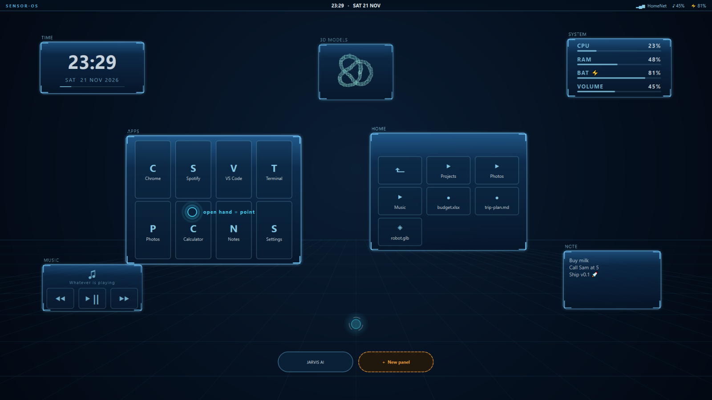

# sensor-OS (ภาษาไทย)

ใช้มือคุมคอมพิวเตอร์ผ่านเว็บแคม พร้อมจอ HUD แบบ JARVIS ไม่ต้องซื้ออุปกรณ์เพิ่ม



> เอกสารหลักเป็นภาษาอังกฤษ: [README.md](../README.md) ฉบับนี้อาจตามไม่ทันทุกรายละเอียด
>
> **ใช้ภาษาไทย:** ใส่ใน `settings.json`
> ```json
> {"language": "th", "jarvis_languages": ["en-US", "th-TH"]}
> ```
> `language` = ข้อความบนจอ, `jarvis_languages` = ภาษาที่ JARVIS ฟัง (ตัวแรกเป็นภาษาหลัก) พูดภาษาไหน JARVIS ก็ตอบภาษานั้นด้วยเสียงของภาษานั้น อยากให้ไทยเป็นหลักก็ใส่ `"th-TH"` ไว้ก่อน เปลี่ยนเสียงได้ด้วย `jarvis_voice` (เสียงผู้หญิง: `th-TH-PremwadeeNeural`)
>
> คำสั่งง่ายๆ เช่น "เปิด Chrome", "เพิ่มเสียง", "ปิดเสียง" ทำทันทีโดยไม่ต้องรอ AI

## ติดตั้ง (ครั้งเดียว)

ต้องใช้ Python 3.12 เพราะ MediaPipe ยังไม่รองรับเวอร์ชันใหม่กว่า

```bash
py -3.12 -m venv .venv
```

```bash
.venv\Scripts\python -m pip install -r requirements.txt
```

## รัน

```bash
.venv\Scripts\python main.py
```

เปิดครั้งแรกจะมีขั้นตอน **ตั้งค่ามือราว 7 วินาที** ขึ้นกลางจอ (แบมือ → จีบนิ้วชี้) เพื่อปรับความไวการจีบให้เข้ากับมือคุณ ทำตามข้อความบนจอได้เลย

| คำสั่ง | ใช้ทำอะไร |
|---|---|
| `main.py --dry-run` | ซ้อมท่า เห็น HUD ครบแต่ไม่แตะเมาส์จริง |
| `main.py --calibrate` | ตั้งค่ามือใหม่ (ถ้าคลิกไม่ติดหรือคลิกเอง) |
| `main.py --debug` | เปิดหน้าต่างกล้องด้วย ไว้ดูว่ากล้องเห็นมือชัดไหม |
| `main.py --mode wrist` | เปิดในโหมดข้อมือ |
| `main.py --camera 1` | ใช้กล้องตัวอื่น |
| `main.py --autostart on` / `off` | เปิดเองตอนล็อกอิน |

**คีย์ลัด (กดที่ไหนก็ได้)**

| ปุ่ม | ผล |
|---|---|
| `Ctrl+Alt+Q` | เปิด/ปิดการควบคุม |
| `Ctrl+Alt+G` | เรียกแผงทั้งหมดขึ้นมา / เก็บ |
| `Ctrl+Alt+J` | คุยกับ JARVIS โดยไม่ต้องเรียกชื่อ |
| `Ctrl+Alt+A` | เปลี่ยน AI ของ JARVIS |
| `Ctrl+Alt+C` | ตั้งค่ามือ |
| `Ctrl+Alt+M` | สลับโหมด |
| `Ctrl+Alt+H` | แสดง/ซ่อนวิธีใช้ |
| `Ctrl+Alt+X` | ออกจากโปรแกรม |

## โต๊ะกระจก (โหมดหลัก)

เปิดแล้ว sensor-OS ยึดทั้งจอเหมือนเป็นระบบปฏิบัติการ: ซ่อนแถบงานและไอคอน มีแถบสถานะด้านบน และแผงกระจกที่ใช้แทนเมนู Start กับแถบงาน ข้างใต้ยังเป็นเดสก์ท็อปเดิม โปรแกรมเดิมใช้ได้หมด เริ่มต้นจอจะโล่ง ตบมือ, `Ctrl+Alt+G` หรือพูดว่า "แสดงแผง" จะเรียกแผงทั้งหมดขึ้นมาทีเดียว

**จำแค่สองท่า: จีบ = แตะ, กำ = จับ**

| ทำอะไร | ผล |
|---|---|
| แบมือแล้วขยับ | ตัวชี้ตามมือ |
| จีบบนโปรแกรม | คลิก (จีบค้าง = คลิกขวา, จีบแล้วลาก = ลาก) |
| จีบบนปุ่มของแผง | กดปุ่มนั้น |
| จีบแล้วดึงแผง หรือกำ | ถือแผงไปด้วย แบมือ = วาง |
| อีกมือจับแผงเดียวกัน | ยืด / หด |
| สองมือกำบนที่ว่างแล้วกาง | สร้างแผงใหม่ แล้วเลือกว่าจะใส่อะไร (หรือกำป้าย + ที่ล่างจอ) |
| ดึงไฟล์ออกจากแผงไฟล์ | ไฟล์หลุดออกมาเป็นแผงของตัวเอง |
| ถือแผงแล้วดึงมือเข้าหากล้อง / ถอยออก | แผงมาข้างหน้า / ไปข้างหลัง |
| **ลากแผงออกนอกขอบจอจนขอบแผงเป็นสีแดง แล้วปล่อย** | ทิ้ง (หน้าต่างโปรแกรมจริงจะไปอยู่ชั้นล่างจอ ไม่ปิดโปรแกรม) |
| ตบมือ | เก็บแผงทั้งหมด / เอากลับมา |

แผงที่สร้างเองถูกบันทึกใน `space.json` ออกด้วย `Ctrl+Alt+X` หรือแผงเครื่อง

**โมเดล 3D:** จีบบนโมเดลแล้วขยับ = หมุน, จีบแล้วดึงออกจากตัวโมเดล หรือกำ = ถือไปด้วย (ลากออกนอกจอ = ทิ้ง), อีกมือจับตาม = ขยายและเอียง, แตะสั้นๆ = เริ่ม/หยุดหมุนเอง วางไฟล์ `.obj` `.stl` `.glb` `.gltf` `.ply` ไว้ใน `models3d/` ได้

## JARVIS: ผู้ช่วยที่คุยด้วยเสียง

พูด **"Hey Jarvis"** หรือแค่ **"จาร์วิส"** (หรือกด `Ctrl+Alt+J`) แล้วพูดได้เลย เช่น "เปิด Chrome", "เปิดยูทูบเพลงผ่อนคลาย", "เปิดโฟลเดอร์ดาวน์โหลด", "เพิ่มเสียง", "ความสว่าง 40", "จดว่าพรุ่งนี้ซื้อนม", "แบตเหลือเท่าไหร่" หรือพูดชื่อพร้อมคำสั่งในประโยคเดียวก็ได้ ("จาร์วิส เปิด YouTube") ตอบเสร็จจะฟังต่ออีกไม่กี่วินาทีโดยไม่ต้องเรียกชื่อซ้ำ และจำบทสนทนาก่อนหน้าได้

- **สมอง:** ใช้ AI จากแพ็กเกจที่คุณมีอยู่แล้ว เลือกใน `settings.json` ด้วย `"jarvis_brain"`: `"chatgpt"` (Codex CLI, ตอบราว 2 วิ), `"claude_code"` (Claude Code), `"gemini"` (Gemini CLI + API key) สลับด้วย `Ctrl+Alt+A` หรือพูดว่า "ใช้ ChatGPT" / "ใช้ Claude"
- **บริการที่เชื่อมไว้ (ผ่าน Claude):** เช่น "มีอีเมลใหม่ไหม", "สรุปอีเมลที่ยังไม่ได้อ่าน", "หาไฟล์งบใน Drive" งานที่แค่อ่านทำเลย ส่วนงานที่ส่ง สร้าง แก้ หรือลบ JARVIS จะถามก่อน ต้องพูด **"ยืนยัน"** ถึงจะทำ เพิ่มบริการได้ด้วย `"jarvis_tools": ["Notion"]`
- **ปลอดภัย:** AI สั่งได้แค่คำสั่งในรายการ (`sensor_os/jarvis/actions.py`) ปิดหน้าต่าง สลีป รีสตาร์ท และปิดเครื่อง ต้องพูด "ยืนยัน" ก่อน
- **ความเป็นส่วนตัว:** ภาพกล้องไม่ออกจากเครื่อง คำว่า "Hey Jarvis" ตรวจในเครื่อง หลังเรียกแล้วเสียงที่พูดถูกส่งให้ Google แปลงเป็นข้อความ ประโยคสั้นๆ ที่พูดเดี่ยวๆ ก็ถูกส่งไปเช็กว่ามีชื่อ JARVIS ไหม (ปิดด้วย `"jarvis_name_check": false`) เสียงตอบมาจาก Microsoft และคำขอของคุณไปที่ AI ที่คุณเลือก
- ต้องเปิดสิทธิ์ไมโครโฟนให้แอปเดสก์ท็อปใน Windows (Settings > Privacy > Microphone) ปิด JARVIS ด้วย `"jarvis_enabled": false`

## โหมดอื่น

- **โหมดโฮโลแกรม:** เดสก์ท็อปปกติพร้อมชั้นโฮโลแกรม วงแหวนอยู่ตรงจุดจีบ กำมือหยิบหน้าต่างทั้งบาน ท่ากรงเล็บดึงหน้าต่างถัดไปมาหามือ มีลูกบิดเสียง ความสว่าง และปุ่มเพลงแบบ 3D
- **โหมดข้อมือ:** ทัชแพดกลางอากาศ แบ = เลื่อน, จีบ = คลิก, ชู 3 นิ้ว = เลื่อนหน้าจอ, กำ = พัก, กำสองมือ = ซูม
- **เวที:** ภาพกล้องเต็มจอพร้อมการ์ดหน้าต่างสดให้จัดด้วยสองมือ (ยกสองมือแบค้างไว้ หรือ `Ctrl+Alt+S`)

## ปรับความไว

ค่าทั้งหมดอยู่ใน [sensor_os/config.py](../sensor_os/config.py) และใส่ค่าทับใน `settings.json` ได้

| อาการ | ปรับ |
|---|---|
| คลิกไม่ติด / คลิกเอง | รัน `--calibrate` ใหม่ก่อน |
| เคอร์เซอร์เร็วหรือช้าไป | `cursor_speed` |
| เล็งของเล็กยาก | ลด `gain_slow` |
| เคอร์เซอร์สั่นตอนมือนิ่ง | ลด `filter_min_cutoff` หรือเพิ่ม `move_deadzone` |
| ตั้งใจคลิกแต่กลายเป็นลาก | เพิ่ม `drag_move` / `holo_drag_move` |
| เรียก JARVIS ไม่ติด | ลด `jarvis_wake_threshold` (ค่าเริ่มต้น 0.3) |
| JARVIS ตื่นเอง | เพิ่ม `jarvis_wake_threshold` หรือ `"jarvis_name_check": false` |
| เครื่องช้าลงเมื่อมีสองมือในกล้อง | `max_hands = 1` |

## ข้อจำกัด

- กล้องใช้ได้ทีละโปรแกรม ถ้ามีโปรแกรมอื่นใช้กล้องอยู่ ภาพจะดำและช้า
- แสงน้อยหรือย้อนแสงทำให้จับมือหลุด
- แม่นพอสำหรับใช้งานทั่วไป แต่ไม่เท่าเมาส์จริง
- หน้าต่างที่รันแบบ Administrator จะไม่รับคำสั่ง ถ้าไม่ได้รัน sensor-OS แบบ Administrator ด้วย
- Mac และ Linux มีโค้ดแล้วแต่ยังไม่เคยทดสอบบนเครื่องจริง
